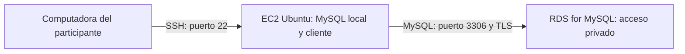

# Guía del participante: MySQL en EC2 y Amazon RDS

**AWS Student Builder Group — UPSLP**

Aprende a instalar MySQL en un servidor de Amazon EC2 y después a usar Amazon RDS for MySQL como alternativa administrada. Usaremos una pequeña base de datos de alumnos e inscripciones para observar qué cambia cuando AWS administra la infraestructura del motor.

**Práctica guiada:** 1 hora dentro de un evento de 2 horas. **Nivel:** introductorio, con conocimientos básicos de SQL.

Esta guía contiene los comandos y resultados esperados para seguir la sesión o repetirla después a tu ritmo. Si la haces por tu cuenta, reserva tiempo adicional para crear recursos y resolver errores; el aprovisionamiento de RDS puede tardar varios minutos.

> Este laboratorio crea recursos que pueden generar cargos. Revisa los costos y las restricciones de tu cuenta antes de comenzar y completa la limpieza al terminar. No supongas que una instancia marcada como elegible para Free Tier será gratuita para tu cuenta.

## Objetivos

Al finalizar podrás:

- Crear un servidor Linux y acceder mediante SSH.
- Instalar MySQL, revisar su servicio y crear usuarios con permisos limitados.
- Crear tablas, insertar datos y ejecutar consultas.
- Crear una instancia de RDS y configurar su acceso desde EC2.
- Ejecutar SQL en ambos entornos y comprobar la conexión a RDS.
- Comparar la administración de MySQL en EC2 con un servicio administrado.

## Cómo usar esta guía

Durante el taller, sigue las secciones 1 a 4 con el instructor, compara los resultados en la sección 6 y termina con la limpieza de la sección 8. Las ampliaciones son opcionales y quedan para después.

Si repites la práctica por tu cuenta, crea tu propia EC2 y tu propio RDS con los pasos completos de esta guía. Puedes iniciar RDS después de crear EC2 y sus grupos de seguridad, y aprovechar la espera para instalar MySQL y ejecutar SQL localmente. Al terminar cada sesión, elimina los recursos; para continuar otro día tendrás que volver a crearlos.

Si el instructor proporciona un RDS, usa el endpoint, usuario y base asignados a tu equipo. No necesitas crear otro RDS ni conocer su contraseña maestra. El instructor autorizará el grupo de seguridad de tu EC2.

- [Antes de comenzar](#1-antes-de-comenzar)
- [Arquitectura y conexiones](#2-arquitectura-del-taller)
- [Práctica A: MySQL en EC2](#3-práctica-a-instalar-mysql-en-ec2)
- [Práctica B: MySQL en RDS](#4-práctica-b-usar-amazon-rds-for-mysql)
- [Migración opcional](#5-ampliación-opcional-trasladar-los-datos-de-ec2-a-rds)
- [Comparación](#6-comparar-lo-aprendido)
- [Solución de problemas](#7-solución-de-problemas)
- [Limpieza obligatoria](#8-limpieza-obligatoria)
- [Comprobación final](#9-comprobación-de-aprendizaje)

## 1. Antes de comenzar

### Requisitos

- Una cuenta de AWS propia o un laboratorio proporcionado por la institución.
- Permisos para crear y eliminar EC2, RDS, grupos de seguridad y pares de claves; en un laboratorio, verifica las restricciones con el instructor.
- Acceso a una VPC con salida a Internet para EC2 y subredes en al menos dos zonas de disponibilidad para el grupo de subredes de RDS. Para simplificar, usaremos la VPC predeterminada si existe.
- Una terminal con cliente SSH: PowerShell en Windows, Terminal en macOS o una terminal Linux.
- Conocimientos básicos de `CREATE TABLE`, `INSERT` y `SELECT`.

Elige **una misma región** para todos los recursos y anótala. Usa nombres que distingan tu trabajo, por ejemplo `taller-ec2-tu-nombre` y `taller-rds-tu-nombre`. Agrega una etiqueta `Proyecto=taller-bd`.

### Costos y credenciales

Revisa la estimación de la consola antes de crear los recursos. EC2, sus discos EBS, las direcciones IPv4 públicas, RDS, el almacenamiento y los respaldos pueden generar cargos. Los presupuestos de AWS ayudan a detectar gastos; no son un límite automático de consumo.

Las condiciones de Free Tier dependen de la fecha de creación, el plan y los créditos de tu cuenta. Consulta las condiciones actuales de [AWS Free Tier para RDS](https://aws.amazon.com/rds/free/) y [Free Tier para EC2](https://docs.aws.amazon.com/AWSEC2/latest/UserGuide/ec2-free-tier-usage.html).

No subas contraseñas, archivos `.pem` ni respaldos con datos sensibles al repositorio. En esta práctica usa únicamente datos ficticios. Escribe las contraseñas cuando el cliente las solicite, sin incluirlas en el comando.

### Dónde ejecutar cada instrucción

- **Consola AWS:** navegador, para crear y configurar recursos.
- **Terminal local:** tu computadora, para iniciar SSH.
- **Terminal EC2:** sesión SSH en Ubuntu, para comandos Linux.
- **Consola MySQL:** prompt `mysql>`, para instrucciones SQL.

Los textos `IP_PUBLICA_EC2`, `ENDPOINT_RDS` y `REEMPLAZA_CON_UNA_CLAVE_UNICA` son marcadores: reemplázalos por tus valores. No copies el prompt `mysql>`.

## 2. Arquitectura del taller



En la primera práctica MySQL escucha localmente en EC2 y lo usamos desde SSH. En la segunda, esa misma EC2 ejecuta el cliente para conectarse a RDS. **No necesitamos abrir el puerto 3306 de EC2 a Internet.**

| Grupo de seguridad | Entrada | Origen |
| --- | --- | --- |
| `sg-taller-ec2` | SSH / TCP 22 | Tu IP pública actual (`/32`) |
| `sg-taller-rds` | MySQL/Aurora / TCP 3306 | ID de `sg-taller-ec2` |

Para esta práctica conserva la salida predeterminada del grupo de EC2. Si el laboratorio restringe la salida, requiere acceso para descargar paquetes por Internet y conectarse a RDS en TCP 3306. Nunca configures `0.0.0.0/0` como origen de MySQL.

## 3. Práctica A: instalar MySQL en EC2

### 3.1 Crear el servidor

En **EC2 → Instances → Launch instances**:

1. Nombre: `taller-ec2-tu-nombre`.
2. Imagen: **Ubuntu Server 24.04 LTS**, publicada por Canonical, arquitectura **x86_64**.
3. Tipo: una instancia pequeña disponible en tu cuenta, por ejemplo `t3.micro`; revisa su precio y elegibilidad.
4. Crea o selecciona un par de claves. Si lo creas, descarga el archivo `.pem` y guárdalo de forma privada.
5. Red: la VPC elegida, una subred pública con ruta a un Internet Gateway y asignación de IPv4 pública habilitada.
6. Grupo de seguridad: `sg-taller-ec2`, con SSH desde **My IP**. No agregues una regla para MySQL.
7. Disco: 10 GiB de EBS `gp3`; verifica que esté habilitada su eliminación al terminar la instancia.
8. Lanza la instancia y espera a que esté en estado **Running** y apruebe las comprobaciones de estado.

Anota su IP pública, su VPC y el ID de su grupo de seguridad. Si tu cuenta no tiene VPC predeterminada, pide al instructor los datos de la red antes de continuar.

### 3.2 Conectarse por SSH

En la **terminal local**, desde la carpeta que contiene tu clave:

```bash
ssh -i "taller-bd.pem" ubuntu@IP_PUBLICA_EC2
```

En Linux o macOS, restringe antes los permisos del archivo:

```bash
chmod 400 taller-bd.pem
```

En Windows usa PowerShell y conserva la clave en una carpeta privada de tu usuario. Si SSH rechaza sus permisos, restringe el acceso desde las propiedades de seguridad del archivo. El nombre de usuario de la imagen Ubuntu es `ubuntu`.

Verifica el sistema dentro de **EC2**:

```bash
cat /etc/os-release
whoami
```

**Punto de control:** ves Ubuntu 24.04 y el usuario `ubuntu`.

### 3.3 Instalar y revisar MySQL

Ejecuta en la **terminal EC2**:

```bash
sudo apt update
sudo apt install -y mysql-server mysql-client curl
sudo systemctl enable --now mysql
sudo systemctl status mysql --no-pager
mysql --version
```

El servicio debe indicar `active (running)`. La instalación sigue el procedimiento de [MySQL en Ubuntu Server](https://ubuntu.com/server/docs/install-and-configure-a-mysql-server).

Revisa dónde escucha el servicio:

```bash
sudo ss -lntp | grep 3306
```

La configuración de Ubuntu normalmente limita MySQL a la interfaz local. Mantén esa configuración: no cambies `bind-address` para este taller.

**Ampliación para después del taller:** configuración inicial interactiva. Durante la hora guiada conserva la autenticación local por socket, el acceso limitado a localhost y los permisos del usuario de práctica. Después puedes ejecutar:

```bash
sudo mysql_secure_installation
```

Los prompts dependen de la versión. Puedes habilitar validación de contraseñas; elimina usuarios anónimos y la base de prueba, deshabilita el acceso remoto de `root` y recarga privilegios cuando se solicite. La instalación de Ubuntu normalmente permite administrar como `root` mediante el socket local y `sudo`, sin una contraseña de MySQL para ese usuario. No cambies ese mecanismo para seguir la práctica.

### 3.4 Crear la base y un usuario

Abre la **consola MySQL local**:

```bash
sudo mysql
```

Ejecuta el siguiente SQL. Sustituye la contraseña por una única que cumpla la política configurada:

```sql
CREATE DATABASE taller_cloud
  CHARACTER SET utf8mb4
  COLLATE utf8mb4_unicode_ci;

CREATE USER 'taller'@'localhost'
  IDENTIFIED BY 'REEMPLAZA_CON_UNA_CLAVE_UNICA';

GRANT SELECT, INSERT, UPDATE, DELETE, CREATE, REFERENCES
  ON taller_cloud.* TO 'taller'@'localhost';

SHOW GRANTS FOR 'taller'@'localhost';
EXIT;
```

Este usuario trabaja únicamente sobre `taller_cloud`. No necesita permisos globales ni `FLUSH PRIVILEGES` después de `CREATE USER` y `GRANT`.

Conéctate desde la **terminal EC2** como participante:

```bash
mysql -u taller -p taller_cloud
```

En la **consola MySQL** crea los datos del ejercicio:

```sql
CREATE TABLE alumnos (
  id INT AUTO_INCREMENT PRIMARY KEY,
  nombre VARCHAR(100) NOT NULL,
  carrera VARCHAR(100) NOT NULL
);

CREATE TABLE inscripciones (
  id INT AUTO_INCREMENT PRIMARY KEY,
  alumno_id INT NOT NULL,
  taller VARCHAR(100) NOT NULL,
  fecha DATE NOT NULL,
  FOREIGN KEY (alumno_id) REFERENCES alumnos(id)
);

INSERT INTO alumnos (nombre, carrera) VALUES
  ('Ana', 'Ingenieria en Sistemas'),
  ('Luis', 'Ingenieria en Tecnologias'),
  ('Sofia', 'Ingenieria en Sistemas');

INSERT INTO inscripciones (alumno_id, taller, fecha) VALUES
  (1, 'Bases de datos en la nube', CURRENT_DATE()),
  (2, 'Bases de datos en la nube', CURRENT_DATE()),
  (3, 'Bases de datos en la nube', CURRENT_DATE());

SELECT a.nombre, a.carrera, i.taller, i.fecha
FROM alumnos AS a
JOIN inscripciones AS i ON i.alumno_id = a.id
ORDER BY a.id;

SELECT COUNT(*) AS total_alumnos FROM alumnos;
EXIT;
```

**Punto de control:** la consulta muestra tres inscripciones y el conteo devuelve `3`. Ejecuta el bloque una sola vez; repetirlo completo provocará errores de tablas existentes o duplicará registros.

### 3.5 Ampliación opcional: reinicio y registros

En la **terminal EC2**:

```bash
sudo systemctl restart mysql
sudo systemctl is-active mysql
sudo journalctl -u mysql -n 20 --no-pager
```

Vuelve a conectar y consulta los alumnos. Reiniciar el servicio no elimina los datos del disco.

Reflexiona: ¿quién actualiza Ubuntu y MySQL?, ¿quién crea los respaldos?, ¿cómo recuperaríamos la base si se pierde el disco?, ¿qué pasa durante una falla del servidor?

## 4. Práctica B: usar Amazon RDS for MySQL

RDS administra el servidor del motor y ofrece herramientas de respaldo, mantenimiento y disponibilidad. Seguimos siendo responsables de los datos, el esquema, usuarios, permisos, red y configuración del servicio.

**Elige tu caso:** si trabajas en tu propia cuenta, completa las secciones 4.1 y 4.2. Si usas un RDS proporcionado en el taller, revisa su configuración con el instructor y pasa a la sección 4.3 con las credenciales de tu equipo.

### 4.1 Crear el grupo de seguridad de RDS

En **EC2 → Security Groups**:

1. Crea `sg-taller-rds` en la **misma VPC que EC2**.
2. Agrega una entrada **MySQL/Aurora**, TCP **3306**.
3. En origen selecciona el **ID del grupo `sg-taller-ec2`**, no tu IP pública.

La regla permite conexiones de las interfaces que tienen asociado ese grupo. Es el patrón descrito en la documentación de [acceso a RDS desde una EC2 en la VPC](https://docs.aws.amazon.com/AmazonRDS/latest/UserGuide/USER_VPC.Scenarios.html).

### 4.2 Crear tu instancia administrada

En **RDS → Databases → Create database** selecciona la creación estándar. Los nombres de las opciones pueden variar con el idioma, la región y los permisos de la cuenta.

| Opción | Valor para el taller |
| --- | --- |
| Motor | MySQL, no Aurora ni MariaDB |
| Versión | Una versión MySQL 8.x disponible con soporte estándar; preferentemente compatible con la versión local |
| Plantilla | Free Tier si aplica a tu cuenta; en caso contrario, desarrollo/pruebas |
| Disponibilidad | Una instancia Single-AZ |
| Identificador | `taller-rds-tu-nombre` |
| Usuario maestro | `admin_taller` |
| Credenciales | Contraseña administrada por ti para esta práctica; guárdala de forma privada |
| Clase | Una clase pequeña disponible, por ejemplo `db.t3.micro` o `db.t4g.micro`; revisa precio y compatibilidad |
| Almacenamiento | Mínimo permitido para el tipo elegido; revisa el estimado |
| Autoescalado de almacenamiento | Deshabilitado para este laboratorio breve |
| VPC | La misma que EC2 |
| Grupo de subredes | Uno de esa VPC con subredes en al menos dos zonas de disponibilidad |
| Acceso público | **No** |
| Grupo de seguridad | `sg-taller-rds` |
| Puerto | `3306` |
| Base de datos inicial | Dejar vacía; la crearemos mediante SQL |
| Respaldos | Retención de 1 día para observar la función |
| Cifrado de almacenamiento | Habilitado |
| Protección contra eliminación | Deshabilitada para facilitar la limpieza del taller |

Si aparece una opción de conectar automáticamente con EC2, omítela: aquí configuramos manualmente los grupos para entender la red. Revisa los costos de opciones adicionales de observabilidad antes de activarlas. Si la consola exige otra configuración en tu cuenta, consúltala con el instructor y revisa su estimación antes de crear.

Espera a que RDS indique **Available**. En **Connectivity & security**, copia su **endpoint** y puerto. El endpoint es un nombre DNS, no una URL ni una IP fija.

### 4.3 Conectarse desde EC2 con TLS

Ejecuta en la **terminal EC2**. Usa el endpoint completo de tu instancia. El siguiente comando usa `admin_taller` para un RDS propio; si usas el RDS del taller, cambia `--user=admin_taller` por el usuario que te asignaron.

```bash
curl --fail --show-error --location \
  https://truststore.pki.rds.amazonaws.com/global/global-bundle.pem \
  --output "$HOME/global-bundle.pem"

export RDS_HOST='ENDPOINT_RDS'

mysql --host="$RDS_HOST" --port=3306 --user=admin_taller --password \
  --ssl-ca="$HOME/global-bundle.pem" --ssl-mode=VERIFY_IDENTITY
```

`VERIFY_IDENTITY` verifica el certificado y el nombre del servidor, además de cifrar la conexión. Este bundle corresponde a regiones comerciales de AWS; para otras particiones consulta los [certificados y conexiones TLS de RDS](https://docs.aws.amazon.com/AmazonRDS/latest/UserGuide/UsingWithRDS.SSL.html).

En la **consola MySQL de RDS**, el siguiente bloque corresponde a un RDS propio. Si usas una base asignada por el instructor, ejecuta únicamente las dos consultas de verificación y `EXIT;`: tu usuario no necesita crear bases.

```sql
SELECT VERSION(), @@hostname;
SHOW SESSION STATUS LIKE 'Ssl_cipher';

CREATE DATABASE taller_cloud
  CHARACTER SET utf8mb4
  COLLATE utf8mb4_unicode_ci;
EXIT;
```

**Punto de control:** puedes conectar y `Ssl_cipher` muestra un valor no vacío. No puedes entrar por SSH al sistema operativo de RDS ni administrar su servicio con `systemctl`.

### 4.4 Repetir el ejercicio SQL en RDS

Vuelve a conectar con el comando de la sección 4.3 y ejecuta lo siguiente. Si el instructor te asignó otra base, sustituye `taller_cloud` por ese nombre:

```sql
USE taller_cloud;
```

Copia el bloque de creación de tablas, inserciones y consultas de la sección 3.4. No repitas `CREATE DATABASE` ni la creación del usuario local. El SQL de tablas y datos funciona en ambos entornos.

**Punto de control:** en RDS también obtienes tres alumnos y tres inscripciones. Aquí ejecutamos el mismo SQL por separado; no hemos migrado ni sincronizado los datos.

En un RDS propio, el usuario maestro se usa para esta práctica de administración. Para uso cotidiano, crea un usuario con permisos limitados; tienes un ejemplo en la sección 5.3. En un RDS del taller, trabaja únicamente en la base de tu equipo con el usuario asignado. Si no tienes permisos para crear tablas, consulta al instructor.

## 5. Ampliación opcional: trasladar los datos de EC2 a RDS

**Fuera de la práctica de una hora.** Esta es una migración pequeña con un respaldo lógico. Realízala en una instancia de práctica propia antes de limpiarla, o vuelve a crear los recursos en otra sesión. Requiere una base de destino vacía: si completaste la sección 4.4, crea una nueva base llamada `taller_migracion` en RDS y sustituye `taller_cloud` por `taller_migracion` únicamente en los comandos y permisos del destino de esta sección; conserva `taller_cloud` como origen del dump en EC2. Durante la exportación y hasta terminar la verificación, deja de modificar los datos locales. Una migración de producción requiere planear compatibilidad, consistencia y tiempo de interrupción.

### 5.1 Exportar la base local

En la **terminal EC2**, usa el administrador local para exportar sin ampliar los permisos del usuario del ejercicio:

```bash
umask 077
sudo mysqldump --single-transaction --no-tablespaces \
  --set-gtid-purged=OFF taller_cloud > taller_cloud.sql
```

Comprueba inmediatamente que terminó sin errores:

```bash
echo $?
ls -lh taller_cloud.sql
```

El código debe ser `0` y el archivo debe tener contenido. Si falla, corrige el error y repite la exportación antes de importar. El respaldo contiene tablas y datos; no traslada los usuarios del servidor.

### 5.2 Importar a RDS

En la misma **terminal EC2**, con `RDS_HOST` definido y la base vacía creada en RDS:

```bash
mysql --host="$RDS_HOST" --port=3306 --user=admin_taller --password \
  --ssl-ca="$HOME/global-bundle.pem" --ssl-mode=VERIFY_IDENTITY \
  taller_cloud < taller_cloud.sql
```

Introduce la contraseña maestra de RDS y comprueba el resultado:

```bash
echo $?
```

Debe devolver `0`. Si se interrumpe, inspecciona el error antes de repetir: una importación parcial puede haber creado tablas o insertado registros.

### 5.3 Crear un usuario de práctica en RDS

Vuelve a conectar como `admin_taller` usando el comando de la sección 4.3. En la **consola MySQL de RDS**:

```sql
CREATE USER 'taller'@'%'
  IDENTIFIED BY 'REEMPLAZA_CON_UNA_CLAVE_UNICA'
  REQUIRE SSL;

GRANT SELECT, INSERT, UPDATE, DELETE
  ON taller_cloud.* TO 'taller'@'%';
EXIT;
```

El host `%` admite distintos hosts a nivel de MySQL; el grupo de seguridad limita el acceso de red a EC2 y `REQUIRE SSL` exige una conexión cifrada. Usa este usuario para el trabajo cotidiano, reservando el maestro para administración.

Conecta desde la **terminal EC2**:

```bash
mysql --host="$RDS_HOST" --port=3306 --user=taller --password \
  --ssl-ca="$HOME/global-bundle.pem" --ssl-mode=VERIFY_IDENTITY \
  taller_cloud
```

Verifica en **MySQL de RDS**:

```sql
SHOW TABLES;
SELECT COUNT(*) AS total_alumnos FROM alumnos;
SELECT COUNT(*) AS total_inscripciones FROM inscripciones;

SELECT a.nombre, i.taller
FROM alumnos AS a
JOIN inscripciones AS i ON i.alumno_id = a.id
ORDER BY a.id;

SHOW SESSION STATUS LIKE 'Ssl_cipher';
EXIT;
```

**Resultado esperado:** dos tablas, tres alumnos, tres inscripciones y una conexión TLS activa. Los datos locales siguen existiendo: exportar e importar copia los datos, no elimina la base de origen ni mantiene ambos destinos sincronizados.

## 6. Comparar lo aprendido

| Responsabilidad | MySQL en EC2 | MySQL en RDS |
| --- | --- | --- |
| Sistema operativo | Lo administras y actualizas | Lo administra AWS |
| Instalación del motor | Instalas paquetes y configuras el servicio | Seleccionas motor y versión |
| Mantenimiento del motor | Planeas y ejecutas actualizaciones | Configuras ventanas y opciones de mantenimiento |
| Respaldos | Diseñas, ejecutas y verificas tu estrategia | Configuras retención y verificas restauraciones |
| Alta disponibilidad | Diseñas la arquitectura | Puedes configurar Multi-AZ; este taller usa Single-AZ |
| Acceso al sistema operativo | SSH y permisos del servidor | Sin acceso SSH al servidor administrado |
| Usuarios, SQL y esquema | Tu responsabilidad | Tu responsabilidad |
| Red, acceso y costos | Tu responsabilidad | Tu responsabilidad |

Preguntas para repasar:

1. ¿Qué cambiarías para alojar datos reales de una aplicación?
2. ¿Por qué RDS no necesita acceso público en esta arquitectura?
3. ¿Cuándo necesitarías el control del sistema operativo que ofrece EC2?
4. ¿Por qué tener respaldos no basta si nunca has probado una restauración?
5. ¿Qué pasaría si EC2 falla? ¿Y si falla la única instancia Single-AZ de RDS?

**Reto posterior a la migración opcional:** inserta un alumno y su inscripción en RDS con el usuario `taller`. Comprueba que la base local conserva sus tres alumnos. Explica por qué los cambios no se replican automáticamente.

## 7. Solución de problemas

| Síntoma | Qué revisar |
| --- | --- |
| SSH termina por timeout | IP pública actual de EC2, regla TCP 22 desde tu IP, ruta al Internet Gateway y restricciones de la red de la universidad |
| SSH: `Permission denied (publickey)` | Usuario `ubuntu`, clave del par seleccionado y permisos del archivo |
| `apt` no descarga paquetes | Salida a Internet, resolución DNS y reglas de salida de EC2 |
| MySQL local no inicia | `sudo systemctl status mysql --no-pager` y `sudo journalctl -u mysql -n 50 --no-pager` |
| `Access denied` en MySQL local | Usuario, contraseña y host; para administrar en Ubuntu usa `sudo mysql` |
| RDS termina por timeout | Estado Available, endpoint, misma VPC, entrada 3306 en el grupo de RDS desde el grupo realmente asociado a EC2 y reglas de salida/NACL |
| RDS: `Access denied` | Usuario y contraseña del destino; las credenciales locales no se copian con el dump |
| Error de certificado TLS | Bundle descargado correctamente, reloj del sistema y endpoint real de RDS; no reemplaces el hostname por una IP |
| `Unknown database` | Crea `taller_cloud` en RDS antes de importar |
| Error de permisos en el dump | Usa `sudo mysqldump` y las opciones indicadas en la sección 5.1 |
| Error de tablas existentes al importar | Comprueba si hubo una importación anterior o parcial; no borres tablas sin revisar qué contienen |
| No aparecen algunas opciones de AWS | Restricciones del laboratorio, región, plantilla o permisos; consulta al instructor |

No resuelvas un timeout habilitando MySQL para todo Internet. Identifica qué regla o ruta está impidiendo la conexión.

## 8. Limpieza obligatoria

Haz esta sección al finalizar, aunque no hayas completado ambas prácticas. Elimina únicamente los recursos que creaste para el taller. Si RDS o su grupo de seguridad pertenecen al instructor, él se encarga de eliminarlos; tú revisa y elimina tus propios recursos de EC2.

1. Sal del cliente MySQL y de la sesión SSH con `exit`.
2. En RDS elimina `taller-rds-tu-nombre`. Si habilitaste protección contra eliminación, desactívala primero. Para los datos ficticios de este laboratorio, omite el snapshot final y no conserves respaldos automatizados. Si necesitas conservar datos, exporta o toma un snapshot antes de eliminar y considera su costo.
3. Espera a que termine la eliminación y revisa snapshots manuales y respaldos retenidos asociados al taller.
4. En EC2 **termina** `taller-ec2-tu-nombre`. Detenerla no elimina su disco ni todos los cargos asociados.
5. Revisa que su volumen EBS se haya eliminado. Elimina volúmenes, snapshots y direcciones Elastic IP del taller que hayan quedado, si los creaste.
6. Elimina `sg-taller-rds` y después `sg-taller-ec2` cuando no tengan interfaces asociadas. La regla de RDS referencia al grupo de EC2.
7. Elimina el par de claves de AWS si era exclusivo del taller y su archivo local. Si creaste grupos de subredes exclusivos, elimínalos cuando ya no estén en uso. Conserva la VPC y recursos compartidos del laboratorio.
8. Revisa Billing y los recursos de la región utilizada. La información de facturación puede tardar en actualizarse.

**Comprobación final:** no quedan instancias, discos, respaldos ni otros recursos facturables creados para el taller.

## Referencias

- [Instalar y configurar MySQL en Ubuntu](https://ubuntu.com/server/docs/install-and-configure-a-mysql-server).
- [Crear y conectar una base MySQL en RDS](https://docs.aws.amazon.com/AmazonRDS/latest/UserGuide/CHAP_GettingStarted.CreatingConnecting.MySQL.html).
- [Conectar EC2 con RDS](https://docs.aws.amazon.com/AWSEC2/latest/UserGuide/tutorial-connect-ec2-instance-to-rds-database.html).
- [Conectarse a una instancia RDS MySQL](https://docs.aws.amazon.com/AmazonRDS/latest/UserGuide/USER_ConnectToInstance.html).
- [TLS y certificados de RDS](https://docs.aws.amazon.com/AmazonRDS/latest/UserGuide/UsingWithRDS.SSL.html).

Guía preparada para fines educativos. Antes de empezar, verifica la región, el presupuesto y las restricciones de la cuenta; durante el taller, sigue las indicaciones del instructor.
